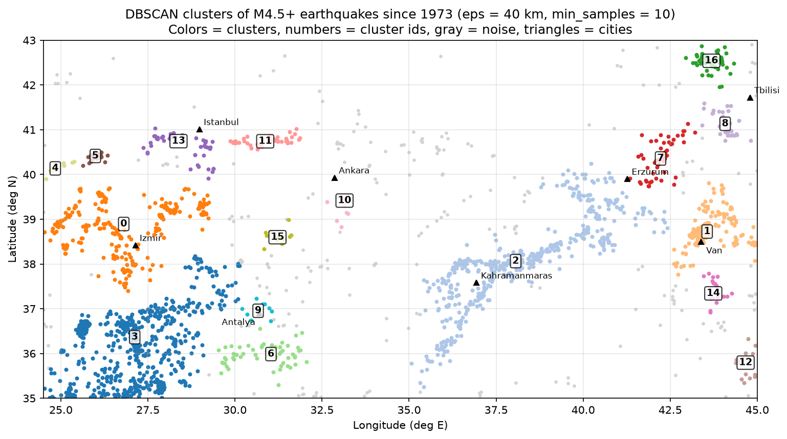
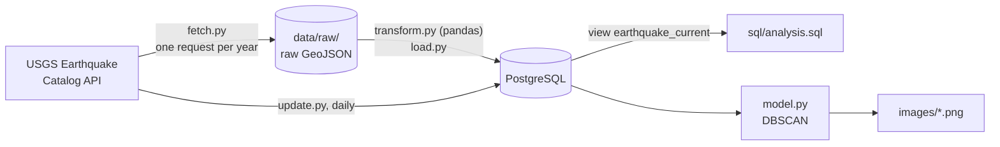
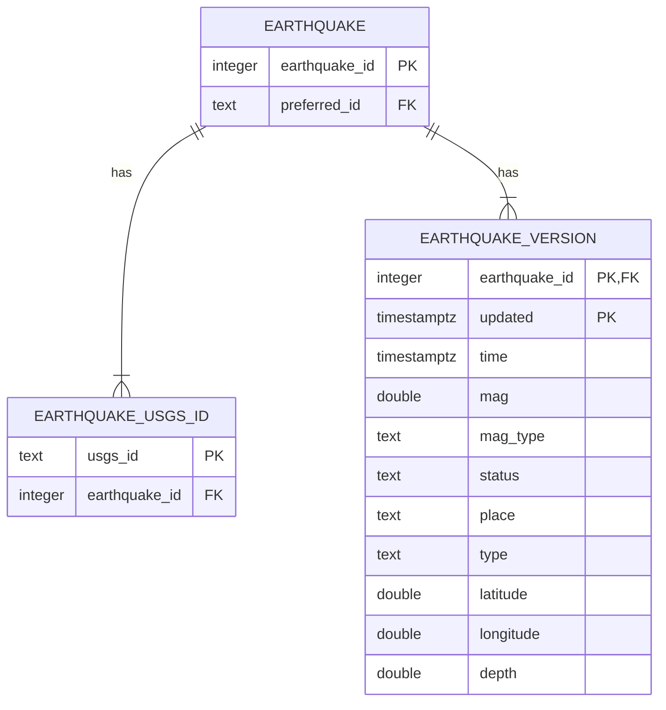

# Earthquake Data Pipeline

An end-to-end data pipeline for earthquakes in and around Turkey. It downloads
the USGS Earthquake Catalog, cleans the data with pandas, stores it in
PostgreSQL, updates it every day, analyzes it with SQL, and finds seismic zones
with DBSCAN clustering.



> This project describes where earthquakes happened in the past. It does **not**
> predict earthquakes.

**Tech stack:** Python, pandas, psycopg, requests, scikit-learn, matplotlib,
PostgreSQL, Windows Task Scheduler

## Features

- **Full load** of all M2.5+ events since 1900 in the region latitude 35–43°N,
  longitude 24.5–45°E (about 27,000 events).
- **Daily incremental update:** fetches only the events USGS changed since the
  last load, and keeps every revision of an event as a separate version.
- **Idempotent, transactional load:** running it again adds nothing; a failed
  run leaves the database unchanged.
- **SQL analysis:** 10 queries on catalog completeness, magnitude and depth
  distributions, active areas and the 2023 Kahramanmaraş sequence.
- **Clustering:** DBSCAN on epicenters (M4.5+ since 1973, haversine distance)
  finds 17 seismic zones, such as the East Anatolian Fault, the Hellenic arc and
  the Marmara Sea.

## Architecture



## Database schema



- `earthquake`: one row per earthquake, with our own id.
- `earthquake_usgs_id`: every USGS id of an earthquake (one event can have several).
- `earthquake_version`: every revision USGS published; the primary key is
  `(earthquake_id, updated)`.
- The view `earthquake_current` returns the latest version of each earthquake.

## How to run

Requirements: Python 3 and PostgreSQL. Commands are for Windows PowerShell.

```powershell
git clone https://github.com/TurgayEfeSari/earthquake-data-pipeline.git
cd earthquake-data-pipeline
python -m venv .venv
.venv\Scripts\Activate.ps1
pip install -r requirements.txt
```

Create an empty PostgreSQL database, copy `.env.example` to `.env` and fill in
the connection details. Then:

```powershell
psql -U earthquake_app -d earthquake_db -f sql/schema.sql
psql -U earthquake_app -d earthquake_db -f sql/views.sql

python src/fetch.py      # download the raw data
python src/load.py       # load it into PostgreSQL
python src/update.py     # daily incremental update
python src/model.py      # clustering and charts
```

To update the database every day, schedule `run_update.bat` with Windows Task
Scheduler. The analysis queries are in `sql/analysis.sql`.

## Results

- The catalog is complete from about **M4.5**; below that, the number of events
  follows the station networks, not the earthquakes.
- In the area of the 2023 Kahramanmaraş rupture (35.5–39°N, 35.5–39.5°E) there
  were only 3 M4.5+ earthquakes in all of 2022, but 161 in February 2023 alone.
  (The whole region had 45 M4.5+ earthquakes in 2022.)
- DBSCAN finds clusters that match known tectonic structures, although it uses
  only coordinates: the **East Anatolian Fault** (with the 2023 Elbistan branch),
  the **Hellenic arc**, the **Aegean and western Anatolia**, the **Marmara Sea**,
  **İzmit–Düzce**, **Van** and others.

## Limitations

- The clusters show where M4.5+ earthquakes happened since 1973, not where the
  faults are. The central North Anatolian Fault, whose large earthquakes
  happened before 1973, is mostly noise.
- USGS uses different magnitude scales in different periods, and about half of
  the depths are fixed default values (0, 10 or 33 km).
- The region is a rectangle, so zones that cross its edges are cut.

## Project structure

```
earthquake-data-pipeline/
├── images/              # charts made by model.py
├── sql/
│   ├── schema.sql       # tables, constraints, index
│   ├── views.sql        # view earthquake_current
│   └── analysis.sql     # analysis queries
├── src/
│   ├── db.py            # database connection (reads .env)
│   ├── fetch.py         # extract
│   ├── transform.py     # transform
│   ├── load.py          # load
│   ├── update.py        # daily incremental update
│   └── model.py         # DBSCAN clustering and charts
├── run_update.bat       # entry point for Windows Task Scheduler
├── .env.example         # template for database credentials
└── requirements.txt
```
